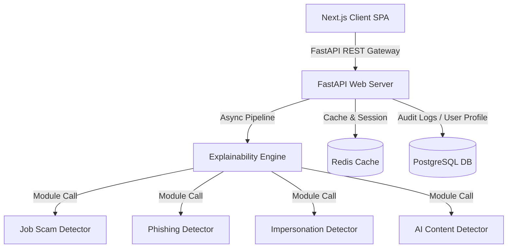

# SENTINEL: Enterprise Fraud Detection & Neural Analysis Engine
## Complete Technical Architecture & System Documentation

Welcome to the official technical documentation for **SENTINEL**, an enterprise-grade cybersecurity and fraud detection platform. This document provides a exhaustive, granular analysis of what the engine does, the underlying technologies utilized, the codebase structure, and how each component works together.

---

## Table of Contents
1. [Executive Overview & Purpose](#1-executive-overview--purpose)
2. [Core Capabilities & Detection Modules](#2-core-capabilities--detection-modules)
3. [System Architecture & Technology Stack](#3-system-architecture--technology-stack)
4. [Backend (FastAPI) Code Deep Dive](#4-backend-fastapi-code-deep-dive)
5. [Frontend (Next.js) & State Management Deep Dive](#5-frontend-nextjs--state-management-deep-dive)
6. [Database Schema & Cache Topology](#6-database-schema-cache-topology)
7. [Directory Structure Walkthrough](#7-directory-structure-walkthrough)
8. [Configuration & Deployment Protocol](#8-configuration--deployment-protocol)

---

## 1. Executive Overview & Purpose

**SENTINEL** is a high-density digital security platform engineered to identify, intercept, and explain fraudulent digital activities. Social engineering tactics—such as job scams, phishing websites, and impersonation—have grown increasingly sophisticated. Sentinel addresses this by analyzing input vectors (emails, messages, job postings, URLs, and profile photos) through a multi-layered neural and heuristic pipeline.

### The Problem
Traditional threat detection relies on static lists of signatures or simple keyword match lists. Attackers bypass these easily by changing URLs or altering phrasing. 

### The Sentinel Solution
Sentinel analyzes **semantic intent**, **structural patterns**, **linguistic indicators**, and **visual signals** using advanced neural heuristics. The system does not just return a binary "scam or not" response. Instead, it aggregates scores across multiple specific detection sub-modules, computes a unified **confidence and risk rating**, identifies specific **triggered signals**, and highlights the **exact text spans** causing the alert to provide end-users with full transparency.

---

## 2. Core Capabilities & Detection Modules

Sentinel leverages several independent AI and algorithmic analysis engines:

### A. Employment Fraud (Job Scam Detector)
- **What it does**: Scans job postings and recruitment descriptions.
- **Key Indicators Checked**: Upfront fees, suspicious request for personal documentation (e.g., SSN, credit scores), salary/compensation anomalies (e.g., overpayment for low-skill work), generic or free email domains (e.g., Gmail, ProtonMail) used by corporate recruiters, and company spoofing.

### B. Recruiter Scam Detector
- **What it does**: Specifically analyzes direct communications from recruiters (messages, DMs, or emails).
- **Key Indicators Checked**: Urgent language, unsolicited outreach, requests to move conversations to encrypted messaging platforms (e.g., WhatsApp, Telegram), and grammatical anomalies.

### C. Phishing & Link Analyzer
- **What it does**: Inspects URLs and the textual contexts around links.
- **Key Indicators Checked**: Domain age, Top-Level Domain (TLD) risk score, sub-domain hijacking, credential harvesting structures, and lexical distance from official domains (e.g., `paypal-security-update.com`).

### D. Identity Integrity (Impersonation Detector)
- **What it does**: Compares profile pictures or submitted credentials using image neural analysis (pre-loaded with LFW - Labeled Faces in the Wild dataset weights) to detect spoofed profiles or generative AI-created faces.

### E. AI Content Detector
- **What it does**: Evaluates text content using linguistic entropy, perplexity, and burstiness to detect if the text was programmatically generated by Large Language Models (LLMs) like GPT or Claude.

### F. News Credibility & Disinformation Analyzer
- **What it does**: Evaluates articles or news updates to detect sensationalized language, known fake news outlets, and manipulation tactics.

---

## 3. System Architecture & Technology Stack

Sentinel is architected as a distributed microservice application configured for instant containerization:



### Backend Technology Stack
*   **FastAPI (Python 3.11)**: Utilized for high-performance, asynchronous REST APIs. Leverages Python's native `asyncio` for non-blocking I/O.
*   **SQLAlchemy & Alembic**: Object-Relational Mapper (ORM) and migration framework handling database interactions and schemas securely.
*   **Structured JSON Logging**: The entire logging framework converts standard console logs into JSON output (`python-json-logger`), making the backend ready for enterprise aggregators (like Datadog or ELK stack).
*   **SlowAPI**: Provides robust rate-limiting to prevent Denial of Service (DoS) and API abuse.

### Frontend Technology Stack
*   **Next.js 16 (React)**: High-performance React framework using the App Router for optimal rendering, file-based routing, and modern performance optimizations.
*   **Zustand**: Lightweight, decoupled state management store for managing authentication tokens, analysis history, UI theme states, and live scan logs.
*   **Framer Motion**: Powering hardware-accelerated animations, micro-interactions, layout transitions, and dynamic visual indicators.
*   **Vanilla CSS Variables**: Employs a sophisticated dark/glassmorphic custom UI style system, skipping TailwindCSS to allow maximum layout control.

### Shared / Infrastructure
*   **Docker & Docker Compose**: Configured to spin up PostgreSQL, Redis, Frontend, and Backend with a single command.
*   **Redis**: Caches API analysis requests, manages active sessions, and keeps rate-limit records.
*   **PostgreSQL**: Secure, ACID-compliant database for user accounts, historical scans, API keys, and configurations.

---

## 4. Backend (FastAPI) Code Deep Dive

The backend structure uses a clean modular design that separates endpoint routing, model structures, and analysis detectors.

### Base Detector Pattern
All detectors subclass the abstract class `BaseDetector` defined in [backend/app/detectors/base.py](file:///c:/Users/Het%20Upadhyay/Desktop/Sentinel/backend/app/detectors/base.py). They implement a standard async `analyze` signature returning a `DetectorResult` object:

```python
class DetectorResult:
    score: float                        # 0.0 to 100.0 risk score
    confidence: float                   # 0.0 to 100.0 confidence rating
    signals: List[str]                  # Triggered heuristics labels
    spans: List[dict]                   # Highlighted text ranges: {start, end, text, reason}
    metadata: dict                      # Supplemental metrics
```

### Explainability Engine
Located in `backend/app/explainability/engine.py`, the explainability engine orchestrates the scans. When a request is received, it determines which sub-detectors to trigger based on the type of scan requested, fires them in parallel using `asyncio.gather()`, and runs an aggregation algorithm to combine individual detector outputs. 

It calculates:
1.  **Composite Risk Score**: Weighted average based on sub-module importance.
2.  **Global Confidence Score**: Adjusted based on how many sub-detectors returned high-certainty conclusions.
3.  **Aggregated Spans**: Collects and normalizes text highlights from all sub-modules for UI rendering.

---

## 5. Frontend (Next.js) & State Management Deep Dive

The Next.js 16 application is modular and resides under `frontend-next/`.

### App Layouts & Structure
*   **`app/(auth)/`**: Handles registration, login, and secure credentials management.
*   **`app/(app)/app/`**: Contains core dashboard pages:
    *   **Analyze**: The primary workspace. Allows text entry, URL pasting, file uploads, and exhibits interactive highlighted text overlays when results load.
    *   **History**: A searchable log of past scans, displaying historical fraud trends.
    *   **API Keys**: Generating tokens for external system integrations.
    *   **Billing & Settings**: Subscription configurations and user profiles.

### Zustand State Store
State is centrally managed in `frontend-next/src/store/`. Rather than passing callbacks through multiple component levels, state stores handle async API communication, handle token persistence in local storage, and synchronize scanner status globally.

---

## 6. Database Schema & Cache Topology

### PostgreSQL Database
The DB contains the following primary relational structures:
1.  **Users**: Store hashed credentials (using BCrypt), company details, and subscription tiers.
2.  **Scans**: Tracks every transaction processed, including input text, scan type (URL, Email, Job, Impersonation), calculated composite risk score, and structured JSON results for quick retrieval.
3.  **API Keys**: Holds cryptographically hashed API keys for developers using Sentinel services externally.

---

## 7. Directory Structure Walkthrough

```text
sentinel/
├── docker-compose.yml     # Service orchestration configurations (app, db, redis)
├── Dockerfile             # Multi-stage production build configuration
├── .env                   # Configuration file containing application secrets and keys
│
├── backend/               # FastAPI Neural Analysis Backend
│   ├── app/
│   │   ├── api/           # Routing layers (V1 endpoints for analysis, dashboard, history)
│   │   ├── auth/          # Authentication routing, JWT issuance, and login verification
│   │   ├── db/            # Database engine connections, sessions, and tables definition
│   │   ├── detectors/     # Dynamic NLP & heuristic scan sub-modules (Job, AI, Phishing, etc.)
│   │   ├── explainability/# Aggregation engine combining sub-module results
│   │   ├── models/        # SQLAlchemy Database Schemas
│   │   ├── schemas/       # Pydantic schemas validating API Request/Response shapes
│   │   └── main.py        # Central FastAPI initialization, global middleware, & lifespan hook
│   └── requirements.txt   # Backend Python library list
│
└── frontend-next/         # Next.js 16 Enterprise Web Application
    ├── src/
    │   ├── app/           # App router layouts (marketing pages, login panels, dashboard views)
    │   ├── components/    # Atomic UI library containing buttons, forms, and charts
    │   ├── lib/           # Mathematical helpers, text parser hooks, and formatters
    │   └── store/         # Central Zustand state management stores
    ├── package.json       # Frontend project scripts and NPM packages
    └── tsconfig.json      # Strict typescript definitions
```

---

## 8. Configuration & Deployment Protocol

### Environment Variables
Configure the platform by editing `.env` in the root directory:

```env
# Database Settings
POSTGRES_USER=sentinel_admin
POSTGRES_PASSWORD=your_secure_password
POSTGRES_DB=sentinel_db

# Redis Caching Settings
REDIS_PASSWORD=your_redis_password

# Authentication Settings
JWT_SECRET_KEY=long_and_complex_secret_key_here
JWT_ALGORITHM=HS256

# Environment Configurations
APP_ENV=development
COMPOSE_PROJECT_NAME=sentinel
```

### Starting the Platform
Launch the complete stack (Database, Caching, Backend, and Frontend) in background mode with one command:
```bash
docker-compose up --build -d
```

### Verification Endpoints
Once startup is complete, verify system operations:
- **Client Frontend UI**: [http://localhost:3000](http://localhost:3000)
- **Interactive OpenAPI Documentation**: [http://localhost:8000/docs](http://localhost:8000/docs)
- **System Health Endpoint**: [http://localhost:8000/health](http://localhost:8000/health)

---
© 2026 Sentinel Engineering. Created and Architected by Het Upadhyay. All rights reserved.
